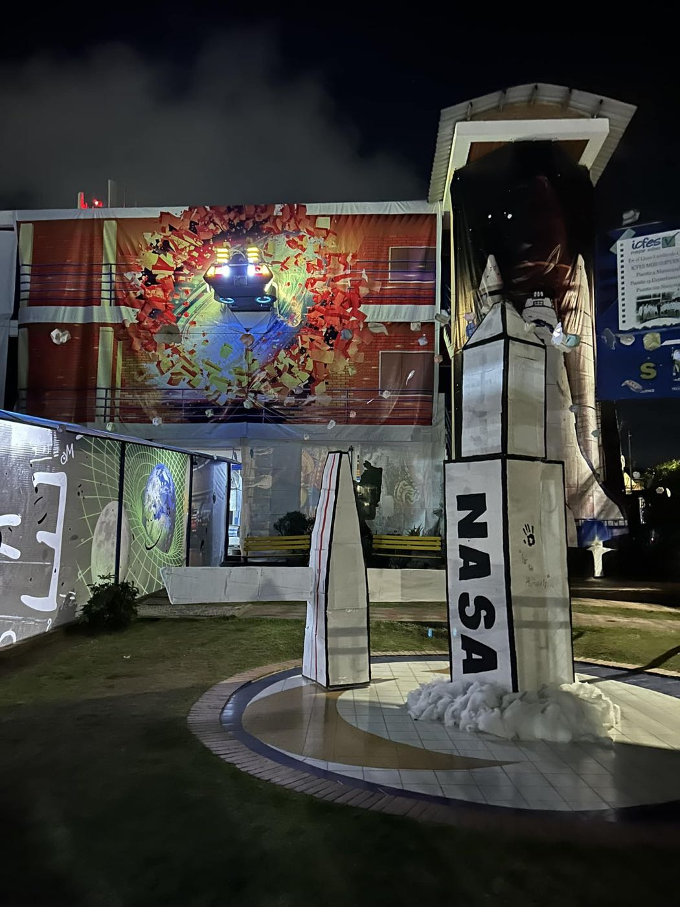
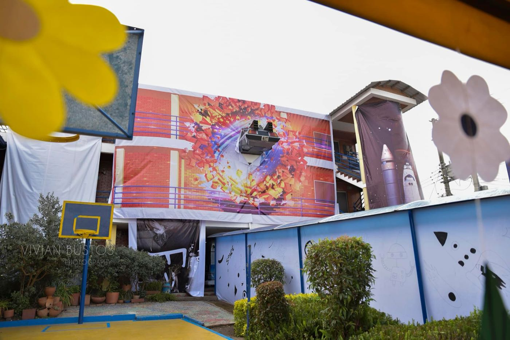

El **viernes 13 de octubre de 2023** es uno de los días más importantes en la historia del Liceo Lunita de Chía. Ese día recibimos al doctor **Michio Kaku**, físico teórico, futurista y uno de los divulgadores científicos más reconocidos del mundo.

## Una visita a Colombia con parada en Lunita

El doctor Kaku estuvo en Colombia **del 12 al 15 de octubre de 2023**, en una gira organizada por el **Instituto de Astrobiología de Colombia** que pasó por Chía, Bogotá y Neiva:

- **13 de octubre, Liceo Lunita de Chía.** Desde las 9:00 a. m., diálogo y almuerzo con maestros y rectores de primaria y secundaria sobre la importancia de la ciencia en la educación.
- **Bogotá.** Gran conferencia en el auditorio de Corferias sobre educación científica, transición energética, inteligencia artificial y el futuro de la humanidad.
- **14 de octubre, desierto de la Tatacoa (Huila).** Observación del eclipse anular de Sol, explicado por el propio Kaku.

## Lunita se vistió de ciencia

Durante semanas, toda la comunidad se preparó para recibirlo. Los estudiantes trabajaron cerca de dos semanas en una **feria de ciencia** para mostrarle sus proyectos, y el colegio entero se transformó: cohetes, planetas y decoración espacial en cada rincón.

El doctor Kaku **recorrió los corredores del colegio, compartió con los estudiantes** y conoció de cerca el enfoque STHEAMI. Ese día, desde Lunita, se firmó el **gran pacto nacional por la educación científica**, abierto a maestros y rectores de todo el país.

## Un día que marcó la historia

La prensa nacional registró la visita. La revista *Cambio* tituló su nota con una frase del científico sobre el colegio: «Captura la imaginación de los jóvenes». Según la rectora Elizabet Barrera, Lunita fue la única institución educativa que el doctor Kaku visitó en su paso por Colombia.

Para nuestros estudiantes, ver a uno de los grandes científicos del mundo caminando por sus aulas fue la prueba de que, en la Ciudad de la Luna, **lo imposible es posible**.
