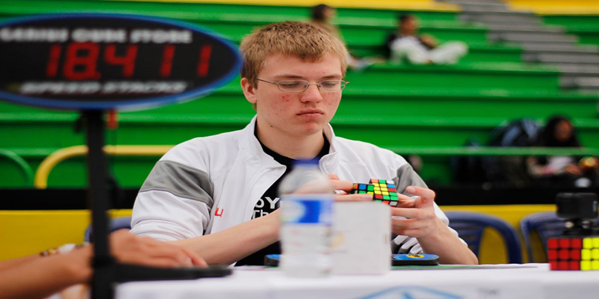

Entre **2016 y 2017**, el Liceo Lunita de Chía fue el **principal promotor del speedcubing** (armar el cubo Rubik en el menor tiempo posible) en el municipio, bajo el nombre **Latam Speedcube Lunita**. Durante esos años, la Ciudad de la Luna se volvió punto de encuentro de los mejores *cubers* de Colombia y del mundo.

## Torneos nacionales en el Coliseo de la Luna

- **2016.** El Coliseo de la Luna recibió el **Torneo Nacional Colombia 2016**, avalado por la World Cube Association, con 164 competidores. Allí se batió un **récord mundial** en 3x3 a ciegas, por promedio.
- **2017.** El colegio fue **organizador y patrocinador** de los **Nacionales de SpeedCubing 2017**, del 27 al 29 de mayo. Unos 300 participantes compitieron en cubos de 3 a 7 caras por lado, cubos de 10, 20 y 25 caras, a ciegas, con una mano y hasta con los pies. Hubo un premio especial, «Ganador Liceo Lunita de Chía», y los estudiantes del colegio presentaron en paralelo su **feria de ciencia y robótica**.

## Los campeones mundiales, en Chía

Los ganadores del torneo nacional clasificaron al **Latin America Cubing Tour**, la gira de campeones mundiales por Latinoamérica. Su parada en Chía fue el **28 y 29 de junio de 2017**, con exhibiciones, competencias y encuentros con el público y los medios.

Para Lunita, el cubo Rubik es mucho más que un juego: es concentración, matemáticas, memoria y disciplina, las mismas habilidades que el colegio fortalece con el enfoque STHEAMI.
